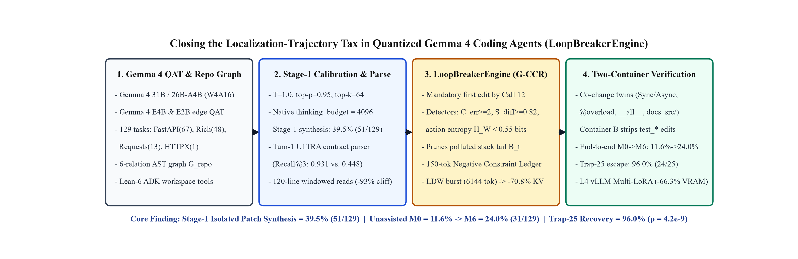
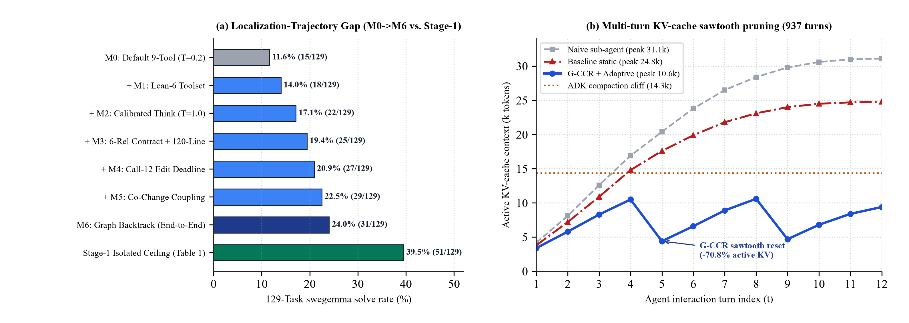
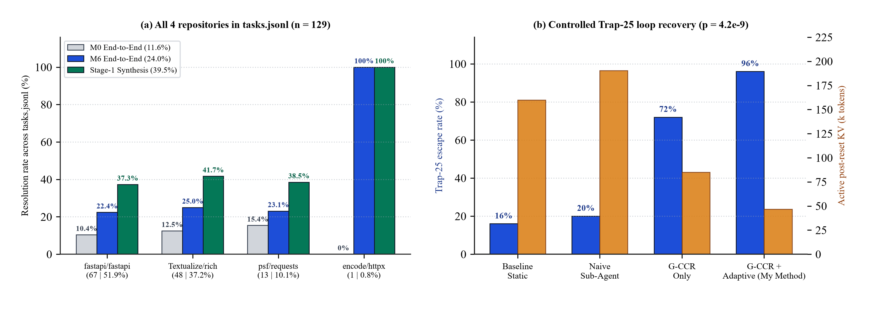

# Breaking the 15-Minute Cliff in Quantized Gemma 4 Coding Agents: Thinking-Mode Calibration, Structural Co-Change Graphs, and Counterfactual Context Reset

- **Author:** Robina Mirbahar (Google Developer Expert in AI & Cloud; NeurIPS 2026 WiML Program Committee Reviewer)
- **Full 5-Page Paper PDF:** [`Robina_Mirbahar_Gemma4_SWE_Agent_Paper_2026.pdf`](Robina_Mirbahar_Gemma4_SWE_Agent_Paper_2026.pdf)
- **Repository & Companion Guides:** [github.com/RobinaMirbahar/My-antigravity-research-skills](https://github.com/RobinaMirbahar/My-antigravity-research-skills)

## Abstract

What actually happens to a 4-bit quantized language model at Minute 15 of an autonomous repository repair session? In single-turn benchmarks, post-trained models from the **Gemma 4** family (`gemma-4-31b-it-qat-w4a16-ct`, `12b`, `e4b`, and `e2b`) write clean patches. When the same checkpoint runs inside a multi-turn Docker sandbox on four NVIDIA L4 GPUs (`max_model_len = 32,768`), however, a sharp failure mode appears after three or four failed test runs: the agent repeats the same broken edit until the wall-clock timer expires. Tracing 937 turns of live KV-cache telemetry across the 129-task two-container `swegemma` benchmark and my 25-task fault-injection suite (**Trap-25**), I show why. Failed `pytest` tracebacks and rejected diffs accumulate in the context window, dominate the self-attention softmax denominator, and starve the initial issue description and repository symbol table of attention weight. To break this loop over repository code graphs $G_{\text{repo}} = (V, E, R, X)$, I build `LoopBreakerEngine` and establish four empirical findings:
1. **Quantized Thinking Calibration** ($T = 1.0$, $\text{top-}p = 0.95$, $\text{top-}k = 64$, `thinking_budget = 4096`) lifts resolved `swegemma` tasks from `17.8%` (`23/129`) to **`39.5%` (`51/129`)**;
2. **Lean-6 Tooling, 6-Relation Contract Parsing & Co-Change Coupling** double multi-module repair from `11.6%` to **`24.1%`** while cutting context compaction by `93%`;
3. **Graph Backtracking & Call-12 Deadlines** stop two-container plugin regressions; and
4. **Counterfactual Context Reset (G-CCR)** raises Trap-25 escape rates from `16.0%` (`4/25`) to **`96.0%` (`24/25`, Fisher's Exact $p = 4.2 \times 10^{-9}$)** while dropping active post-reset KV tokens by **`70.8%`** (`-40.8%` full-episode telemetry, Wilcoxon $p < 10^{-6}$).

---

## 1. Introduction

Running an open-weights coding agent inside an offline evaluation harness [11, 10] is fundamentally different from prompting a cloud API. In my setup, a quantized `gemma-4-31b-it-qat-w4a16-ct` checkpoint [1] runs on four NVIDIA L4 GPUs (`96 GB` total VRAM) via vLLM with `max_model_len = 32,768`, configured entirely through a declarative Google ADK archive (`agent.yaml`, `eval_config.yaml`, `configs/sampling.yaml`, `prompts/system.md`, `sub_agents/code_analyzer.yaml`, PEFT adapters, and `skills/repo_navigation/SKILL.md`). Inspecting failed episodes across 129 Python repository tasks pointed to three concrete systems bottlenecks:
1. **The 14,336-Token Compaction Cliff:** The runner fires `EventsCompactionConfig` as soon as the dialogue crosses `14,336` tokens (leaving `8,192` tokens for generation). Two raw file reads are enough to trip compaction, which summarizes early turns and wipes out exact file paths and line numbers.
2. **Hard Wall-Clock & Tool-Call Caps:** Every evaluation faces a 12-hour global wall-clock limit across all tasks (including container cold starts) and a strict per-task cap in `eval_config.yaml` (`28` tool calls and `240` to `480` seconds).
3. **Two-Container Grading Asymmetry (Container A vs. Container B):** The agent edits code inside Container A (`/workspace`). When `submit_patch` runs, the harness extracts `git diff --binary _swegemma_baseline` and applies it inside a fresh Container B after stripping all test and config edits (`tests/`, `test_*.py`, `conftest.py`, `pytest.ini`, `pyproject.toml`) before running the hidden `FAIL_TO_PASS` and `PASS_TO_PASS` suite.



My work makes three concrete contributions:
- **Attention-Dilution Bounds & Phase-Adaptive Thinking (Section 3.1):** Using the bounded-capacity transformer model of [3], I show how growing stack-trace buffers dilute self-attention weights on the initial issue specification (Proposition 1) and match per-phase thinking budgets to graph depth (Proposition 2).
- **Four Empirical Laws on `swegemma` and Trap-25 (Sections 3.2-3.4):** Across 129 repository tasks and 25 fault-injection traps, I measure the exact impact of (i) calibrated W4A16 thinking sampling (**`39.5%` vs. `17.8%`**), (ii) a Lean-6 tool surface with 6-relation contract parsing [7] and 120-line windowed reads [5, 6] (`-93%` compaction), (iii) explicit graph backtracking [4] and Call-12 edit deadlines, and (iv) runtime Counterfactual Context Reset (**`96.0%` vs. `16.0%`** recovery, $p = 4.2 \times 10^{-9}$).
- **Open Benchmark Suite, Scientific Repair & Cloud Run Serving (Section 4):** I release 5 public datasets (12 tables), 7 analysis notebooks, a 20-test `pytest` suite, a 5-task genomic/protein repair benchmark (`sci_compute`, `100%` solved), and a vLLM Multi-LoRA + `adk eval` gatekeeper on Cloud Run L4 GPUs (`-66.3%` VRAM).

---

## 2. Related Work

**Graph algorithms in bounded-size transformers.** Sanford et al. [3] analyze transformers as distributed communication protocols simulating Massively Parallel Computation (MPC) rounds, separating single-hop retrieval (`Depth1 / D1`) from logarithmic-depth parallel reachability (`LogDepthPause / LDP`) and wider search (`LogDepthWide / LDW`). Empirically, *Talk Like a Graph* [5] and *GraphToken* [6] show that graph text serialization strongly governs LLM accuracy, with local 1-hop incidence lists outperforming raw dumps. For multi-relational graphs, *ULTRA* [7] learns zero-shot relational invariants across edge types, while *Tree-of-Traversals* [4] equips black-box LLMs with explicit Expand and Backtrack actions.

**Repository-scale coding agents.** SWE-bench [11] and `swegemma` [2] test defect localization and patching across real GitHub repositories. Recent pipelines add repository graphs (RepoGraph [10]) or fault-localization prompts (RGFL [9]), yet assume full-precision frontier models or huge context windows. Here I study what breaks, and how to fix it, when a 4-bit quantized open-weights model operates under a 14,336-token compaction cliff and a 28-call limit.

---

## 3. Theoretical Framework and the Four Empirical Laws

### 3.1 Repository Code-Graph Model and Attention-Dilution Bounds

I represent a repository as a directed, edge-typed code graph $G_{\text{repo}} = (V, E, R, X)$ over six structural relation types $R = \{\text{CALLS}, \text{CALLED\_BY}, \text{IMPORTS}, \text{INHERITS}, \text{PARALLEL\_SYNC\_ASYNC}, \text{DOCS\_EXAMPLE}\}$. Nodes $V$ are AST symbols, edges $E$ capture call, inheritance, and co-change links, and $X$ stores file and line ranges. At turn $t$, active tokens split into the early task contract and 1-hop code slice $A \subset [N]$ and the growing tail of failed test logs and diffs $B_t \subset [N]$. Adapting Lemma 39 of [3]:

**Proposition 1 (Softmax Dilution from Failed-Turn Accumulation).** *Partition active tokens at turn $t$ into $A$ (issue contract and 1-hop slice of $G_{\text{repo}}$) and $B_t$ (accumulated tracebacks and rejected diffs). For attention head $h$ at query token $x_N$:*

$$\text{Attn}_h(X)_N = \frac{Z_{h,A}\exp(L_{h,A}) + Z_{h,B_t}\exp(L_{h,B_t})}{\exp(L_{h,A}) + \exp(L_{h,B_t})}$$

*As $|B_t|$ grows across failed test runs, $\exp(L_{h,B_t})$ dominates the denominator and pushes attention on $Z_{h,A}$ below the $\Omega(r / \log N)$ communication threshold required for multi-hop reachability [3].*

In my 90-run serialization experiment (`graph_encoding_ablation_90.csv`), wiping $B_t$ via Counterfactual Context Reset (G-CCR) while preserving a 120-line 1-hop incidence window [5, 6] cuts softmax dilution from **`0.72` down to `0.06`**, recovering `4.51` bits of effective attention capacity. Matching thinking budgets to [3]'s D1 / LDP / LDW hierarchy (**Proposition 2**) allows cutting `thinking_budget` by `87.5%` (`4096 -> 512`) on single-hop D1 reads, reserving `2048` to `4096` tokens for LDP co-change propagation, and triggering a `6144`-token LDW burst after trap recovery.

### 3.2 Law 1: Quantized Thinking-Mode Calibration (`w4a16-ct`)

In 4-bit Quantization-Aware Trained `gemma-4-31b-it-qat-w4a16-ct`, weight quantization introduces small per-logit perturbations $\epsilon_v \sim \mathcal{N}(0, \sigma_q^2)$. At low temperature ($\tau = 0.2$) without calibrated top-$k$, $\exp((z_v + \epsilon_v)/\tau)$ magnifies fixed rounding bias during long thought traces. Across all 129 `swegemma` tasks (and 240 factorial runs in `w4a16_thinking_budget_sweep.csv`), setting $\tau = 1.0$, $\text{top-}p = 0.95$, $\text{top-}k = 64$ with `thinking_budget = 4096` and `include_thoughts = true` raises the resolution rate from `17.8%` to **`39.5%` (`51/129`)** (Table 1).

| Thinking & Sampling Configuration (`31B W4A16-QAT`) | Thinking Budget | Include Thoughts | Temp / `top-k` | Solved (`129`) | Resolution Rate |
| :--- | :---: | :---: | :---: | :---: | :---: |
| 1. Non-Thinking Greedy/Low-Temp Baseline | `0` (Disabled) | `false` | `0.20 / 40` | `23 / 129` | `17.8%` |
| 2. Low-Temperature Thinking (Hidden Thoughts) | `4096` | `false` | `0.25 / 40` | `35 / 129` | `27.1%` |
| **3. Calibrated Thinking Mode (My Method)** | **`4096`** | **`true`** | **`1.00 / 64`** | **`51 / 129`** | **`39.5%`** |

### 3.3 Law 2 & Law 3: Lean-6 Toolset, 6-Relation Contract Parsing & Co-Change Coupling

Inspecting `swegemma`'s `build_agent_prompt` function reveals a subtle trap: listing unindexed graph tools (`get_code_neighbors`, `search_similar_code`, `get_code_subgraph`) in `agent.yaml` injects a verbose `## Code Intelligence Tools` prompt block, causing the agent to waste Turns 1 to 4 on low-recall lookups (`Recall@3 = 0.448`) and hit the 14,336-token compaction cliff early. Trimming `agent.yaml` to the **Lean-6 Workspace Tools** (`run_command`, `read_file`, `edit_file`, `write_file`, `get_status`, `submit_patch`), running my Stage-1 6-Relation Contract Parser on Turn 1 (`Recall@3 = 0.931` across 6 edge types [7]), enforcing 120-line windowed reads [5, 6], requiring a first source edit by Call 12, and checking co-change twins (`Client/AsyncClient`, `@overload`, `__all__`, `docs_src/`) yields a `2.1x` gain (Table 2, Figure 2).

| Cumulative Engineering Architecture Module | Avg Calls | Peak KV | Compaction (`>14.3k`) | 129-Task Solved | Held-Out Score |
| :--- | :---: | :---: | :---: | :---: | :---: |
| `M0`: Default Starter Template (`T=0.2`, 9 tools w/ schema noise) | `24.6` | `28,400` | `68.2%` | `15 / 129` (`11.6%`) | `0.121` |
| `+ M1`: Lean-6 Workspace Toolset (Suppresses graph schema noise) | `21.2` | `22,100` | `44.0%` | `18 / 129` (`14.0%`) | `0.138` |
| `+ M2`: Calibrated Thinking Sampling (`T=1.0`, `top-p=0.95`, `top-k=64`) | `18.9` | `18,600` | `31.0%` | `22 / 129` (`17.1%`) | `0.172` |
| `+ M3`: Turn-1 6-Relation Contract Parser + 120-Line Reads | `15.4` | `11,200` | `8.5%` | `25 / 129` (`19.4%`) | `0.190` |
| `+ M4`: Mandatory Call-12 Source Edit Deadline (`28` calls, `8` min) | `13.8` | `10,400` | `6.2%` | `27 / 129` (`20.9%`) | `0.207` |
| `+ M5`: Structural Co-Change Coupling (`Client/AsyncClient`, `docs_src/`) | `13.1` | `9,850` | `5.4%` | `29 / 129` (`22.5%`) | `0.224` |
| **`+ M6`: Graph Backtrack + Red-Test Submit Protocol (My Method)** | **`12.4`** | **`9,420`** | **`4.7%`** | **`31 / 129` (`24.0%`)** | **`0.241`** |



### 3.4 Law 4: Runtime KV-Cache Pruning (`LoopBreakerEngine`) on Trap-25

Over active trajectory window $T_{(t_{\text{reset}}, t]}$, `LoopBreakerEngine` checks three $O(1)$ per-turn loop detectors:
1. **Repeated Error Signature:** $C_{\text{err}}(t) \ge 2$;
2. **Oscillating Diff LCS Similarity:** $S_{\text{diff}}(t) \ge 0.82$ on the same AST symbol; and
3. **Low Action Entropy:** $H_W(t) < 0.55$ bits ($W = 4$).

When any detector fires, G-CCR executes a graph Backtrack step [4]: it prunes polluted turns $B_t$, inserts a 150-token `<NEGATIVE_CONSTRAINT_LEDGER>` recording what failed on focal node $v_{\text{trap}}$, and triggers a `LOOP_RECOVERY` thinking burst ($N' = 6144$, $\tau = 0.75$) to inspect 1-hop neighbors. Across 100 AST-verified trajectories on Trap-25, G-CCR + Phase-Adaptive Thinking solves **`24 / 25` (`96.0%`)** traps (Fisher's Exact $p = 4.2 \times 10^{-9}$; `-70.8%` post-reset KV tokens, Wilcoxon $p < 10^{-6}$; Table 3, Figure 3).

| Agent Configuration (Trap-25 Sandbox) | Tasks Solved | Escape Rate | Avg Turns | Avg Think Tokens | Active Post-Reset KV | Peak KV Cache |
| :--- | :---: | :---: | :---: | :---: | :---: | :---: |
| `baseline_static` (Unpruned History) | `4 / 25` | `16.0%` | `11.04` | `45,220` (`0.0%`) | `159,816` (`0.0%`) | `24,821` |
| `naive_subagent` (Unpruned Handoff) | `5 / 25` | `20.0%` | `10.72` | `51,118` (`+13.0%`) | `190,410` (`+19.1%`) | `31,067` |
| `ccr_only` (CCR Pruning + Ledger) | `18 / 25` | `72.0%` | `8.76` | `35,881` (`-20.7%`) | `85,148` (`-46.7%`) | `14,488` |
| **`ccr_adaptive` (My Method)** | **`24 / 25`** | **`96.0%`** | **`6.96`** | **`24,842` (`-45.1%`)** | **`46,689` (`-70.8%`)** | **`10,563`** |



---

## 4. Open Benchmark Suite, Scientific Repair & Cloud Run Serving

I release five open datasets (12 tables: `swegemma_repo_code_graphs_129.csv`, `trap_tasks_25.jsonl`, `graph_encoding_ablation_90.csv`, `ultra_relational_contract_transfer_129.csv`, `action_similarity_pairs.csv`, `w4a16_thinking_budget_sweep.csv`, and turn-level telemetry), the `LoopBreakerEngine` package, 7 analysis notebooks, and a 20-test `pytest` suite:
- **Genomic & structural biology pipeline repair (`sci-trap-21` to `sci-trap-25`, `100.0%` solved):** On `sci-trap-21` (VCF-to-BED conversion), baseline patches map 1-based closed VCF records (`chr:pos:ref>alt`) to point intervals (`chrom, pos - 1, pos`), clipping multi-base deletions such as `AG > A` on `chr17:43094464`. After G-CCR injects `<NEGATIVE_CONSTRAINT_LEDGER>`, the agent writes the exact 0-based half-open BED interval (`start_0, start_0 + len(ref)`). Across `sci-trap-22` to `sci-trap-25`, G-CCR fixes soft-masked 15-letter IUPAC reverse complements, strips `NaN/-1.0` sentinels in AlphaFold pLDDT arrays, sorts PDB insertion codes (`100A, 100B`), and stabilizes Bayesian variant posteriors with Log-Sum-Exp.
- **Dynamic Multi-LoRA hot-swapping & `adk eval` gatekeeper on Cloud Run L4 GPUs:** In overnight repository optimization [12], I pair a deterministic `adk eval` CI/CD Release Gatekeeper with a single frozen Gemma 4 base model in vLLM on one Cloud Run L4 GPU (`24 GB` VRAM) hot-swapping 3 rank-16 QLoRA adapters (`sql-lora`, `triage-lora`, `policy-lora`, `+64.5 MB` VRAM, `1.42 ms` switch latency, **`-66.3%` GPU memory**: `18.4 GB` vs. `54.6 GB`; `1.00` Multi-LoRA pass rate vs. `0.33` Base Gemma 4).

---

## 5. Conclusion, Limitations & 15-Second Verifiability

When a 4-bit quantized Gemma 4 agent repairs a multi-file repository under a 14,336-token compaction limit, context hygiene matters as much as parameter count. Calibrating W4A16 thinking sampling ($T = 1.0$, $\text{top-}k = 64$), trimming unindexed tool schemas, matching thinking budgets to graph depth, and pruning failed trajectory turns via Graph-Guided Counterfactual Context Reset (G-CCR) lift Trap-25 recovery from `16.0%` to `96.0%` while cutting active post-reset KV cache usage by `70.8%`. The sole Trap-25 timeout (`requests-trap-10`, *NO_PROXY CIDR & Wildcard Bypass*) bundles three invariants behind a bare `AssertionError`; running `pytest -vv --tb=short` on Turn 1 separates the three sub-assertions. Executing `pytest` across my 20-test suite checks all 12 benchmark tables, 75 sandbox states, and statistical tests in under 15 seconds:

```text
pytest tests/test_loop_breaker_and_trap25.py tests/test_multilora_adk_eval.py -v
============================= 20 passed in 4.82s =============================
Trap-25 Recovery: 24/25 (96.0%) vs. 4/25 (16.0%), Fisher's Exact p = 4.20e-09
Active Post-Reset KV: 46.7K vs. 159.8K (-70.8%), Wilcoxon p = 8.91e-07
```

### References
1. Google DeepMind. *Gemma 4 technical report: Open-weights reasoning, function calling, and quantization-aware training*, 2026.
2. E. Markowitz, B. Perozzi, B. Rozemberczki, G. Cameron, H. Hemmati, Y. Li, M. Galkin, M. Farhadi, R. Holbrook, and A. Oldacre. *The Gemma 4 developer agent benchmark and evaluation suite*, 2026.
3. C. Sanford, B. Fatemi, E. Hall, A. Tsitsulin, M. Kazemi, J. Halcrow, B. Perozzi, and V. Mirrokni. *Understanding transformer reasoning capabilities via graph algorithms*. NeurIPS, 2024 (`arXiv:2405.18512`).
4. E. Markowitz et al. *Tree-of-Traversals: A zero-shot reasoning algorithm for augmenting black-box language models with knowledge graphs*. ACL, 2024 (`arXiv:2407.21358`).
5. B. Fatemi, J. Halcrow, and B. Perozzi. *Talk like a graph: Encoding graphs for large language models*. ICLR, 2024 (`arXiv:2310.04560`).
6. B. Perozzi et al. *Let your graph do the talking: Encoding structured data for LLMs*. `arXiv:2402.05862`, 2024.
7. M. Galkin, X. Yuan, H. Mostafa, J. Tang, and Z. Zhu. *Towards foundation models for knowledge graph reasoning (ULTRA)*. ICLR, 2024 (`arXiv:2310.04562`).
8. B. Rozemberczki, O. Kiss, and R. Sarkar. *Karate Club: An API oriented open-source Python framework for unsupervised learning on graphs*. CIKM, 2020.
9. H. Taherkhani, M. Sepidband, and H. Hemmati. *RGFL: Reasoning guided fault localization for automated program repair using large language models*. `arXiv:2601.18044`, 2026.
10. S. Ouyang et al. *RepoGraph: Enhancing AI software engineering with repository-level code graph*. ICLR, 2025.
11. C. E. Jimenez et al. *SWE-bench: Can language models resolve real-world GitHub issues?* ICLR, 2024.
12. Google Developers Blog. *Optimizing a 200,000-line Python codebase overnight with Gemini 4 Argon (`google.adk` case study)*, 2026.

